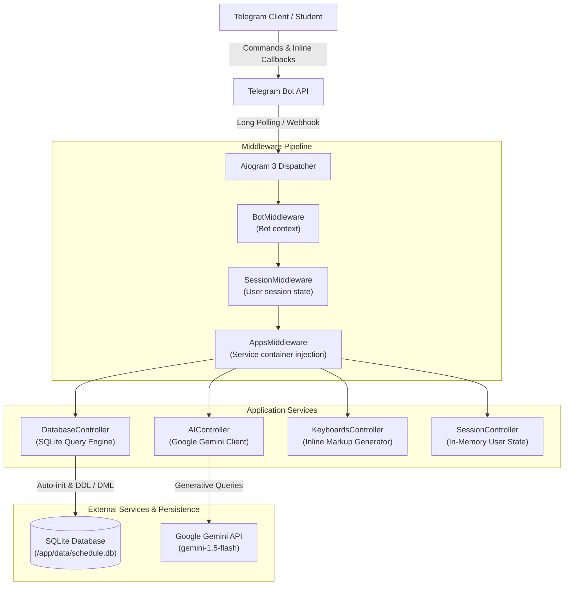

# SUITT Schedule Bot — University Timetable & AI Notes Assistant

[](https://github.com/MarryBye/schedule_bot/actions/workflows/ci.yml)
[](https://www.python.org/downloads/)
[](https://github.com/astral-sh/uv)
[](https://github.com/astral-sh/ruff)
[](https://www.docker.com/)

An intelligent Telegram assistant built for students at the State University of Intelligent Technologies and Communications (SUITT). The bot automates daily and weekly class schedule tracking, calculates academic week parity, delivers direct video conference links, and provides lecture note extraction powered by the Google Gemini API.

---

## Architecture Overview



---

## Key Features

- **Interactive Timetable Navigation:** Browse class schedules across days with interactive inline pagination buttons (`⬅️` / `➡️`), displaying discipline names, lesson types (lecture, practical, lab), times, teachers, and conference join links.
- **Smart Upcoming Lesson Lookup:** Quick evaluation of the next upcoming lesson based on current time and weekday.
- **Academic Week Calculation:** Automatic determination of current semester week parity to accurately filter alternating bi-weekly courses.
- **AI-Powered Lecture Notes & Queries:** Integration with Google Gemini for summarizing course notes and answering timetable queries via `/custom_prompt`.
- **Self-Healing Database Initialization:** SQLite database tables and initial SUITT schedule data are automatically provisioned on startup if no database file exists.
- **Clean Dependency Injection:** Modular service container (`Apps`) injected into all handlers via Aiogram middleware, decoupling business logic from Telegram transport.
- **Lightweight Production Container:** Multi-stage Docker build with non-root security profile and persistent volume mounts.

---

## Bot Commands

| Command | Arguments | Description |
|---|---|---|
| `/start`, `/help` | — | Display bot overview and interactive command list |
| `/show_schedule` | — | Open the daily schedule viewer with interactive navigation buttons |
| `/next_lesson` | — | Retrieve the next upcoming class for the current day |
| `/custom_prompt` | `<prompt>` | Ask Google Gemini a question or request notes analysis |
| `/load_new_schedule` | — | Hot-reload schedule records from a local `schedule.json` file |

---

## Configuration Reference

The application reads runtime configuration from environment variables or a `.env` file located in the project root:

| Variable | Type | Default | Description |
|---|---|---|---|
| `BOT_TOKEN` | String | *Required* | Telegram Bot API token issued by [@BotFather](https://t.me/BotFather) |
| `GROUP_ID` | String | `0` | Telegram group or supergroup ID for broadcast notifications |
| `GEMINI_API_TOKEN` | String | *Optional* | Google Gemini API key from Google AI Studio |
| `GEMINI_USED_MODEL` | String | `gemini-1.5-flash` | Gemini model name used for generative requests |
| `SQLITE_DBFILE` | String | `schedule.db` | Path to the SQLite database file |

---

## Quickstart

### Prerequisites

- [Docker](https://docs.docker.com/get-docker/) & Docker Compose **OR**
- [Python 3.12+](https://www.python.org/) and [`uv`](https://docs.astral.sh/uv/) package manager

### Option 1: Docker Compose (Recommended)

1. Clone the repository:
   ```bash
   git clone https://github.com/MarryBye/schedule_bot.git
   cd schedule_bot
   ```

2. Configure environment variables:
   ```bash
   cp .env.example .env
   # Edit .env with your BOT_TOKEN and GEMINI_API_TOKEN
   ```

3. Launch the container:
   ```bash
   docker compose up -d --build
   ```

4. View logs:
   ```bash
   docker compose logs -f
   ```

The SQLite database file will be stored persistently in the Docker volume `suitt_schedule_bot_data`.

---

### Option 2: Local Development with `uv`

1. Clone the repository:
   ```bash
   git clone https://github.com/MarryBye/schedule_bot.git
   cd schedule_bot
   ```

2. Create environment file:
   ```bash
   cp .env.example .env
   ```

3. Install dependencies and synchronize virtual environment:
   ```bash
   uv sync
   ```

4. Run code formatting and lint checks:
   ```bash
   uv run ruff check .
   uv run ruff format --check .
   ```

5. Run the bot:
   ```bash
   uv run python main.py
   ```

---

## Development & Code Quality

Code quality and linting standards are enforced via [Ruff](https://github.com/astral-sh/ruff) and verified on every commit through GitHub Actions:

```bash
# Check code style and common bugs
uv run ruff check .

# Automatically apply safe lint fixes
uv run ruff check --fix .

# Format code
uv run ruff format .
```

---

## License

This project is licensed under the MIT License.
